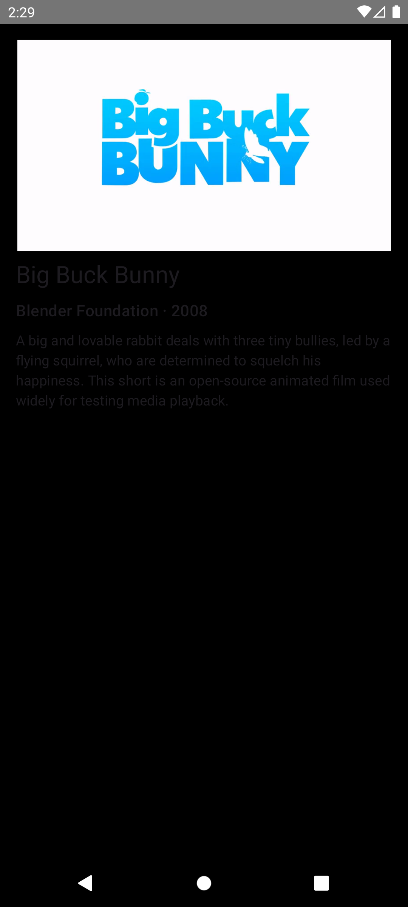
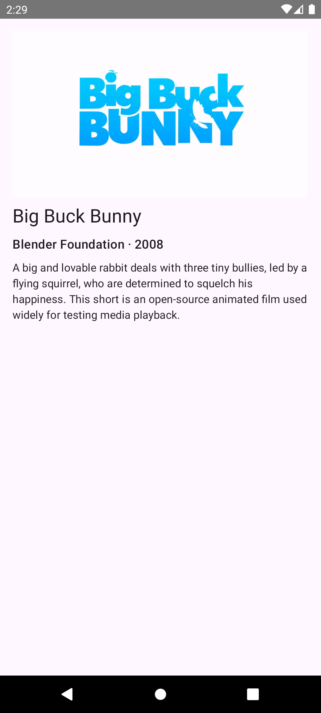

# Media3 Compose Player: `ContentFrame` Android 11 bug repro

This project is a minimal reproduction of a bug in Media3's Compose
`ContentFrame`. On Android 11 (API 30), rendering video through `ContentFrame`
turns the entire screen black, so no content is visible.

It is a tiny Android app, a Media3 (ExoPlayer) video player inside a Jetpack Compose
`Column`, with title, subtitle, and description metadata underneath, stripped down to
isolate the issue.

## The bug

* Using `ContentFrame` (the Compose native player surface) on Android 11, the whole
  screen goes black and the video content cannot be seen.
* Falling back to the classic `PlayerView` via `AndroidView` renders correctly on the
  same device, which points to `ContentFrame` as the culprit.

| `useContentFrame = true` (`ContentFrame`) | `useContentFrame = false` (`AndroidView` / `PlayerView`) |
| :---: | :---: |
|  |  |
| Screen is black, content not visible | Renders correctly |

## Reproducing it

Everything lives in a single file:
`app/src/main/java/com/example/videoplayer/MainActivity.kt`.

There is a `useContentFrame` toggle in `VideoScreen()`:

```kotlin
// Toggle between the Compose native ContentFrame and the classic PlayerView.
// Shows the bug when `true`
val useContentFrame = false
```

* `useContentFrame = true` renders via `ContentFrame`, which reproduces the black screen on Android 11.
* `useContentFrame = false` renders via `PlayerView` in `AndroidView`, which works correctly.

Run on an Android 11 (API 30) emulator or device to observe the difference.

## Run

Open the project in Android Studio (Hedgehog or newer) and press Run.
Android Studio will download the Gradle wrapper JAR automatically on first open.

## What it does

* Builds an `ExoPlayer`, loads a remote HLS test stream, auto plays, and releases it on dispose.
* Renders the player either with Media3's Compose native `ContentFrame` or the classic
  `PlayerView`, at a 16:9 aspect ratio, controlled by the `useContentFrame` flag.
* Shows `title`, `subtitle`, and `description` as Material 3 `Text` below the video.

All copy and the stream URL live in `app/src/main/res/values/strings.xml`.
